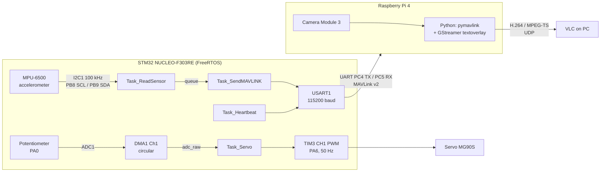
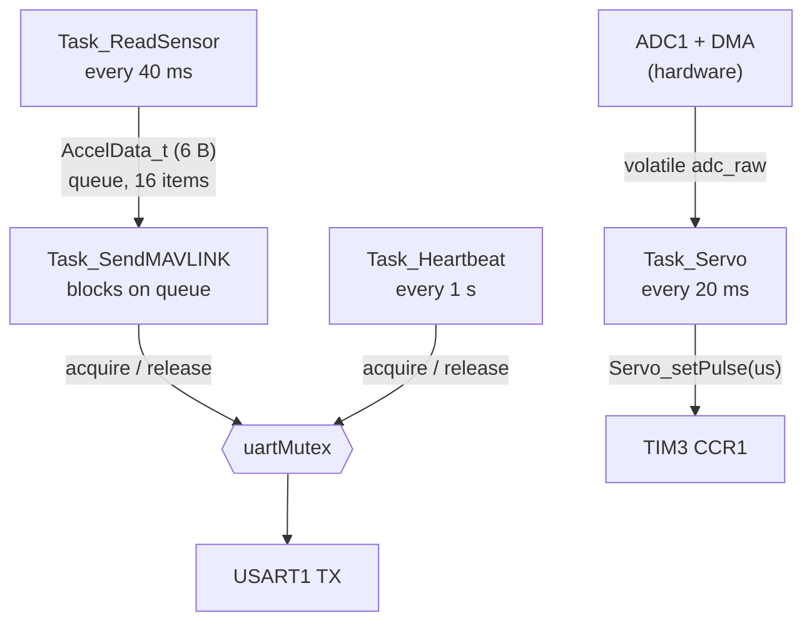

# MP6500-RPI: IMU telemetry with video overlay and a pot-controlled servo

An STM32 (NUCLEO-F303RE) running FreeRTOS reads an MPU-6500 accelerometer, streams the data to a Raspberry Pi 4 as **MAVLink v2** over UART, and drives a hobby servo from a potentiometer. The Raspberry Pi overlays the live accelerometer values on the camera video and streams it over UDP.

The architecture mirrors a drone setup: a microcontroller as the "flight controller" and a Linux companion computer handling video.

https://youtu.be/Zsxq3Zx1Qy4

## Features

- **Register-level I2C driver** for the MPU-6500 (transactions written directly against the CMSIS I2C registers, not HAL I2C calls; pin and clock setup comes from CubeMX): `WHO_AM_I` check, wake-up, 6-byte burst read, NACK and timeout handling, status codes via `enum`.
- **FreeRTOS** (CMSIS-RTOS v2): four application tasks, one queue, one mutex.
- **MAVLink v2** telemetry: `HEARTBEAT` at 1 Hz and `RAW_IMU` at 25 Hz, readable in QGroundControl or `pymavlink`.
- **Servo control**: TIM3 PWM (50 Hz, 900-2800 us) driven by a potentiometer read through **ADC + DMA** (no CPU involvement in sampling).
- **Raspberry Pi side**: GStreamer pipeline (libcamera, hardware H.264 encoder, MPEG-TS over UDP) with a live text overlay of the accelerometer values.

## Architecture



### FreeRTOS tasks and data flow



The mutex exists because two tasks transmit on the same UART: without it their bytes can interleave and corrupt MAVLink frames.

## Hardware

| Part | Connection |
|---|---|
| NUCLEO-F303RE | main board (Cortex-M4F, 72 MHz max, 36 MHz used here) |
| MPU-6500 | I2C1: PB8 (SCL), PB9 (SDA), address `0x68`, `WHO_AM_I = 0x70` |
| Raspberry Pi 4 | UART: PC4 (STM32 TX) to Pi pin 10 (RX), PC5 (STM32 RX) to Pi pin 8 (TX), GND to pin 6 |
| Servo (MG90S) | signal on PA6 (TIM3_CH1), 5 V supply, common GND |
| Potentiometer | wiper on PA0 (ADC1_IN1), ends on 3.3 V and GND |
| Camera Module 3 (IMX708) | CSI connector on the Pi |

`USART2` (PA2/PA3) is wired to the ST-LINK virtual COM port on the Nucleo board, so the Raspberry Pi link uses a separate `USART1` to avoid driving the same lines from two sources.

## Software structure

```
Core/
  Inc/  mpu6500.h  servo.h  tasks.h  main.h ...
  Src/  main.c     mpu6500.c  servo.c  tasks.c ...
```

| Layer | Files | Responsibility |
|---|---|---|
| Drivers (no RTOS dependency) | `mpu6500.c/.h`, `servo.c/.h` | talk to hardware: register access, timeouts, clamping |
| Application tasks | `tasks.c/.h` | RTOS logic: periods, queue, mutex |
| Orchestration | `main.c` (CubeMX generated) | peripheral init, task/queue/mutex creation |

Drivers know nothing about FreeRTOS, so they can be reused in a project without an RTOS.

## Build and flash (STM32)

1. Open the project in **STM32CubeIDE** (workspace containing `MP6500-RPI`).
2. The MAVLink C library is **not** vendored. Clone it and add the `common` folder to the compiler include paths (Project Properties, C/C++ Build, Settings, MCU GCC Compiler, Include paths):
   ```
   git clone https://github.com/mavlink/c_library_v2.git
   ```
   then add `<clone path>/common`.
3. Build and flash with the on-board ST-LINK.

## Raspberry Pi setup

Raspberry Pi OS Lite (64-bit), headless over SSH.

1. Enable the UART and free it from the login console: `sudo raspi-config`, Interface Options, Serial Port (login shell: **No**, serial hardware: **Yes**).
2. Give the full PL011 UART to the GPIO pins by disabling Bluetooth: add `dtoverlay=disable-bt` to `/boot/firmware/config.txt`, then reboot. `/dev/serial0` should point to `ttyAMA0`.
3. Install dependencies:
   ```
   sudo apt install -y gstreamer1.0-tools gstreamer1.0-libcamera gstreamer1.0-plugins-good \
        gstreamer1.0-plugins-bad gstreamer1.0-plugins-base python3-gi
   pip3 install pymavlink pyserial --break-system-packages
   ```
4. Run the overlay stream (set the receiver IP inside the script first):
   ```
   python3 rpi/osd_stream.py
   ```
5. On the PC, open `udp://@:5000` in VLC.

### Run as a systemd service (starts on boot)

Copy the script to `/home/<user>/osd_stream.py` and create `/etc/systemd/system/osd-stream.service` (own services go in `/etc`, not `/usr/lib`, so package updates do not overwrite them):

```ini
[Unit]
Description=OSD stream
After=network-online.target
Wants=network-online.target

[Service]
User=<user>
ExecStart=/usr/bin/python3 /home/<user>/osd_stream.py
Restart=on-failure
RestartSec=5s

[Install]
WantedBy=multi-user.target
```

```
sudo systemctl daemon-reload
sudo systemctl enable --now osd-stream
journalctl -u osd-stream -f
```

- `<user>` must belong to the `video` (camera) and `dialout` (`/dev/serial0`) groups.
- After editing the script run `sudo systemctl restart osd-stream`: `start` does nothing for a service that is already running.
- The script handles `SIGTERM` (sent by `systemctl stop`) and `Ctrl+C`, so the GStreamer pipeline is shut down and the camera is released properly.
- Give the PC and the Pi fixed addresses with DHCP reservations in the router (by MAC address), so the receiver IP in the script does not change between reboots.

To inspect the telemetry without video, point QGroundControl or `pymavlink` at the serial port (115200 baud) and open the MAVLink Inspector: `HEARTBEAT` and `RAW_IMU` should appear, with `xacc/yacc/zacc` around `16384` per g.

## Design notes and problems solved

- **HardFault right after adding the MAVLink tasks.** The default 128-word task stack is smaller than the `mavlink_message_t` plus packet buffer declared as locals, and the 3 KB FreeRTOS heap could not hold all stacks. Fixed by raising the two MAVLink task stacks and `configTOTAL_HEAP_SIZE`.
- **UART ownership.** `USART2` is bridged to the ST-LINK on this board, so the companion link got its own `USART1`.
- **I2C transaction ends.** With `AUTOEND = 0` the end of a phase is flagged by `TC`; with `AUTOEND = 1` the peripheral sends STOP itself and raises `STOPF` instead. Waiting for the wrong flag hangs silently. All waits go through one helper that also checks `NACKF` and a timeout.
- **DMA interrupt storm.** ADC in continuous mode with a one-element circular DMA buffer raises a transfer-complete interrupt after every conversion (hundreds of thousands per second), starving the RTOS tasks. CubeMX force-enables that IRQ, so it is disabled in code after `HAL_ADC_Start_DMA`.
- **Timer clock.** TIM3 runs at 36 MHz here (not 72), so PSC = 35 and ARR = 19999 give 1 us ticks and a 20 ms period.
- **Service restart policy.** `Restart=on-failure` restarts the script after a crash (tested with `kill -9`), but not after `SIGTERM` or a normal exit: `systemd` treats those as clean stops. Python's default `SIGTERM` handling skips the cleanup code, so the script registers its own handler with `GLib.unix_signal_add` to stop the main loop and shut the pipeline down.
- **One reader per serial port.** `/dev/serial0` is read by the video script only; a second process reading it would steal bytes, so any logging belongs in the same reader thread.

## Status and roadmap

Working: sensor to MAVLink to Raspberry Pi to video overlay (started on boot by a `systemd` service), and potentiometer-controlled servo.

Planned:
- Servo command from the Raspberry Pi over UART RX (`Task_ServoControl`), with camera-based motion detection (frame differencing) choosing the direction
- DMA-driven UART transmit
- Demo video and wiring photo
